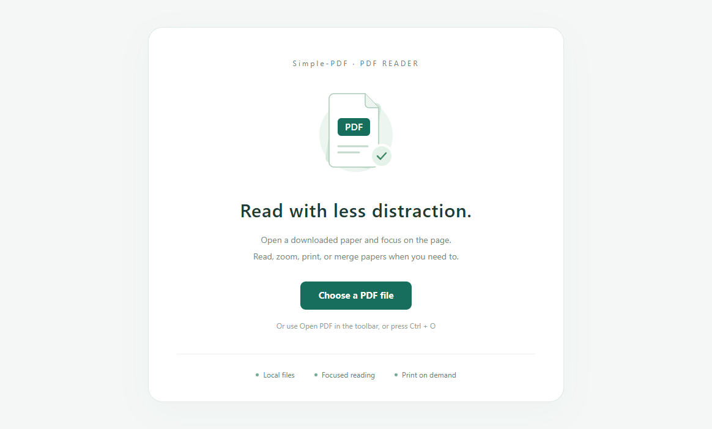

# Simple-PDF

A free, lightweight Windows PDF reader for researchers who want to read papers, print selected pages, and merge PDFs into a new document.



## Why Simple-PDF?

- **Free and open source.** No subscription, account, or paid reading features. The application source is available under the MIT license.
- **Small storage footprint.** The portable application is approximately 2.7 MiB, with a ZIP download of approximately 1.1 MiB, including the PDF merge library. It uses the shared Microsoft Edge WebView2 Runtime rather than bundling an entire browser. These figures exclude that runtime, the .NET Framework, and the runtime's growing profile/cache data.
- **Focused on research reading.** Reading downloaded papers usually needs navigation, search, zoom, and printing. Simple-PDF leaves out editing, OCR, conversion, electronic signatures, cloud services, and other full-suite workflows that many researchers do not need for this task. It offers a compact reading interface instead of the broader toolset of products such as Adobe Acrobat.
- **Local documents.** Simple-PDF reads files from your computer and does not upload them or require a cloud account. The WebView2 Runtime is maintained by Microsoft and may perform its own updates or background services.
- **Local PDF merging.** Combine papers or appendices in your chosen order, preserve page content and dimensions, and save a new PDF without changing the originals.
- **English by default, with a Chinese option.** Change the language in the toolbar. The choice is remembered, and an open document is reopened when the renderer changes language.
- **Portable.** Extract the ZIP and run `Simple-PDF.exe`. No application installer is needed when the prerequisites are already installed.

## Download and start

1. Download `Simple-PDF-Windows-x64.zip` from [Releases](https://github.com/qxyumr-dot/Simple-PDF/releases).
2. Extract the entire folder. Keep the executable, DLLs, and configuration file together.
3. Run `Simple-PDF.exe`.
4. Select **Open PDF**. The file picker starts in your Downloads folder.

You can also drop a PDF onto the executable icon or pass its path on the command line:

```powershell
.\Simple-PDF.exe "C:\Users\YourName\Downloads\paper.pdf"
```

## Read and print

Use the document toolbar for page numbers, zoom, fit-to-page, rotation, and search. Select **Print** to open print preview, choose a printer and page range, and confirm the job.

Select **Full screen** in the application's upper-right toolbar for fullscreen reading. The same button becomes **Exit full screen** and remains visible. Press **Esc** to exit or **F11** to toggle. Exiting restores the previous window size and maximized state without reloading the document.

| Shortcut | Action |
| --- | --- |
| Ctrl+O | Open a local PDF |
| Ctrl+P | Open print preview |
| Ctrl+F | Search the document |
| F11 | Toggle full screen |
| Esc | Exit full screen |

Use the language selector to choose **English** or **Chinese**. A fresh installation defaults to English; later launches remember your selection. Windows-owned file and printer dialogs can still follow the Windows display language.

## Requirements

- 64-bit Windows 10 or Windows 11.
- .NET Framework 4.7.2 or later.
- [Microsoft Edge WebView2 Runtime](https://developer.microsoft.com/microsoft-edge/webview2/).

Page-content editing, annotations, OCR, document conversion, and cloud synchronization are outside the scope of this reader. It uses WebView2's built-in PDF renderer; PDF-specific limitations and print restrictions can depend on the document and runtime.

## Merge PDFs

1. Select **Merge PDFs** in the application toolbar. The currently open PDF is included automatically.
2. Select **Add PDFs** to choose more files; you can select several at once.
3. Use **Move up**, **Move down**, and **Remove** to arrange the list. All pages from each file are appended in that order.
4. Select **Merge and save** and choose a new filename. Existing files cannot be overwritten.
5. Leave **Open the merged PDF when finished** checked to read or print the result immediately.

Merging runs locally in the background and can be canceled. Original files remain unchanged, and failed/canceled operations clean up their temporary output. Page content, dimensions, and rotation are preserved. Encrypted PDFs are currently unsupported. Document-level bookmarks, interactive form functionality, and digital signatures are not carried over to the merged document.

## Build from source

```powershell
git clone https://github.com/qxyumr-dot/Simple-PDF.git
cd Simple-PDF
powershell -ExecutionPolicy Bypass -File .\scripts\build.ps1
```

The build script downloads the pinned WebView2 SDK and PDFsharp merge dependencies from NuGet, compiles the application using the .NET Framework compiler, and creates `dist\Simple-PDF-Windows-x64.zip`. Dependency versions are listed in `dependencies.json`. Internet access is needed for the first restore. `Simple-PDF.csproj` is also provided for Visual Studio/MSBuild after dependency restoration.

```powershell
powershell -ExecutionPolicy Bypass -File .\scripts\test.ps1
```

The tests cover merge page counts, ordered fixtures, rotation and landscape size, unchanged source files, overwrite protection, corrupt/encrypted inputs, cancellation and temporary-file cleanup. The reader smoke tests check English and Chinese screens, merge-list ordering, language switching, special-character filenames, fullscreen exit and window restoration, and opening/printing the merged result. They do not send a physical print job. Merge service tests also run in GitHub Actions.

## Project layout

```text
src/                 Application code, configuration, and translation resources
assets/              Application icon
scripts/             Build and smoke-test scripts
tests/               Merge regression tests and small PDF fixtures
docs/                Screenshots and third-party license
.github/workflows/   Windows build and release automation
```

Application settings and WebView2 profiles are stored under `%LOCALAPPDATA%\Simple-PDF`. Remove that folder while the application is closed to reset language preferences and cached runtime data.

## License

The application is licensed under [MIT](LICENSE). Third-party notices are included in [docs/THIRD-PARTY-NOTICES.txt](docs/THIRD-PARTY-NOTICES.txt) and [docs/WebView2-LICENSE.txt](docs/WebView2-LICENSE.txt). PDFsharp and its managed dependencies use the MIT license; the WebView2 Runtime remains subject to Microsoft's terms.
